# Parte 1. Diseño del proceso de liberación

> Proyecto: **InvenTrack** · Alumno: **[gustavo angel cid flores]** · Matrícula: **[222310413]**

## 1.1 Pasos para preparar una versión liberable

El workflow `release.yml` **reutiliza el pipeline de CI de la Unidad II** (`ci.yml`, llamado con `workflow_call`) y le agrega las etapas de liberación. Así, no se genera ningún artefacto si falla el estilo (Pint), el análisis estático (PHPStan) o alguna prueba.


| # | Paso | Herramienta / comando | Job del workflow |
|---|------|----------------------|------------------|
| 1 | Obtener el código del commit o tag | `actions/checkout@v4` | `ci`, `build-release` |
| 2 | Configurar PHP 8.3 y extensiones | `shivammathur/setup-php@v2` | `ci`, `build-release` |
| 3 | Validar `composer.json` y `composer.lock` | `composer validate --strict` | `ci` (ci.yml) |
| 4 | Instalar dependencias PHP y npm | `composer install` · `npm ci` | `ci` (ci.yml) |
| 5 | Estilo y análisis estático | `pint --test` · `phpstan analyse` | `ci` (ci.yml) |
| 5b | Ejecutar pruebas automatizadas | `php esartisan test` | `ci` (ci.yml) |
| 6 | Calcular el número de versión | `git describe` / tag `vX.Y.Z` | `build-release` |
| 7 | Exportar sólo archivos versionados | `git archive HEAD` | `build-release` |
| 8 | Quitar archivos de desarrollo (tests, .github, phpunit…) | `scripts/build-release.sh` | `build-release` |
| 9 | Instalar dependencias **de producción** | `composer install --no-dev --optimize-autoloader` | `build-release` |
| 10 | Compilar assets (si usa Vite) | `npm ci && npm run build` | `build-release` |
| 11 | Empaquetar y generar checksum | `tar -czf` + `sha256sum` | `build-release` |
| 12 | Verificar contenido (requeridos / sensibles) | `scripts/verify-artifact.sh` | `build-release` |
| 13 | Publicar artefacto | `actions/upload-artifact@v4` | `build-release` |
| 14 | Instalar el artefacto en entorno limpio | `scripts/smoke-test-artifact.sh` | `validate` |
| 15 | Entregar a preproducción | `scp` + `scripts/deploy-preprod.sh` | `deploy-preprod` |

## 1.2 Archivos y dependencias necesarios en otro entorno

**Se incluyen en el artefacto**

| Elemento | Motivo |
|---|---|
| `app/`, `bootstrap/`, `config/`, `routes/`, `resources/`, `database/migrations/` | Código de la aplicación y migraciones |
| `public/` (incluye `index.php` y `build/` de Vite) | Raíz web servida por Nginx/Apache |
| `vendor/` (sólo dependencias de producción) | El servidor no necesita descargar paquetes ni acceso a Packagist |
| `artisan`, `composer.json`, `composer.lock` | Comandos de Laravel y verificación de requisitos (`composer check-platform-reqs`) |
| `storage/` (estructura vacía) | Laravel necesita las carpetas `framework/{cache,sessions,views}` y `logs` |
| `.env.example` | Plantilla de variables (sin valores reales) |
| `VERSION`, `release.json` | Trazabilidad: versión, commit, fecha y número de ejecución |

**Se excluyen**

| Elemento | Motivo |
|---|---|
| `.env`, `.env.*` (excepto `.env.example`) | Contienen credenciales y `APP_KEY` |
| `.git/`, `.github/` | Historial y configuración de CI, no se ejecutan |
| `node_modules/` | Sólo se usan para compilar assets |
| `tests/`, `phpunit.xml`, paquetes `require-dev` | Herramientas de desarrollo |
| `storage/logs/*`, sesiones, caché, `*.sqlite` | Datos locales del desarrollador |
| Llaves (`*.pem`, `*.key`, `id_rsa`), `auth.json` | Información sensible |

**Requisitos del servidor destino:** PHP ≥ 8.2 (se usa 8.3), extensiones `ctype, curl, fileinfo, mbstring, openssl, pdo_mysql, tokenizer, xml, zip, bcmath, intl`, servidor web (Nginx), base de datos MySQL 8 y permisos de escritura en `storage/` y `bootstrap/cache/`.

## 1.3 Estrategia de versiones: Versionado Semántico (SemVer)

Formato **`vMAYOR.MENOR.PARCHE`**

| Cambio | Se incrementa | Ejemplo |
|---|---|---|
| Corrección de errores sin cambiar funciones | PARCHE | `v1.0.0` → `v1.0.1` |
| Nueva funcionalidad compatible | MENOR | `v1.0.1` → `v1.1.0` |
| Cambio incompatible (BD, API, rutas) | MAYOR | `v1.1.0` → `v2.0.0` |

- **Versión oficial:** se crea con un tag de Git; el workflow la toma del nombre del tag.
  ```bash
  git tag -a v1.0.0 -m "Primera liberación"
  git push origin v1.0.0
  ```
- **Candidata (push a `main` sin tag):** `vX.Y.Z-rc.<n_ejecución>+<sha_corto>`, por ejemplo `v1.0.0-rc.12+a1b2c3d`. Así cada commit en `main` genera un artefacto identificable sin "gastar" un número de versión.
- Cada liberación se registra en `CHANGELOG.md`.

## 1.4 Criterios para generar un artefacto de liberación

El artefacto **sólo se genera y publica** si se cumple todo lo siguiente (si algo falla, el pipeline se detiene):

1. ✅ `composer validate` sin errores (`composer.lock` sincronizado).
2. ✅ Dependencias instaladas correctamente.
3. ✅ **100 % de las pruebas automatizadas pasan** (`php artisan test`).
4. ✅ El evento no es un *pull request* (sólo `main`, tags `v*.*.*` o ejecución manual).
5. ✅ La versión cumple el formato SemVer.
6. ✅ El paquete contiene todos los archivos requeridos (`verify-artifact.sh`, sección A).
7. ✅ El paquete **no** contiene `.env`, llaves, logs, `node_modules`, `tests` ni dependencias de desarrollo (sección B).
8. ✅ No se detectan secretos escritos en el código (sección C).
9. ✅ El checksum SHA-256 coincide al descargarlo.
10. ✅ El paquete se instala en un entorno limpio: `migrate`, `config:cache`, `route:cache` y respuesta HTTP 200 (`smoke-test-artifact.sh`).

## 1.5 Diagrama del flujo CI → entrega en preproducción

```mermaid
flowchart TD
    DEV([👩‍💻 Desarrollador]) -->|git push main / git tag vX.Y.Z| GH[(Repositorio GitHub)]
    GH --> TRIGGER{{GitHub Actions<br/>release.yml}}

    subgraph CI["① Integración continua · ci.yml (Unidad II, reutilizado)"]
        A1[Checkout del código] --> A2[Setup PHP 8.3 + Node 20]
        A2 --> A3[composer validate · composer install · npm ci]
        A3 --> A4[Pint · PHPStan · npm run build]
        A4 --> A5[php artisan test]
    end

    TRIGGER --> A1
    A5 -->|❌ falla| STOP1([⛔ Pipeline detenido<br/>no se genera artefacto])
    A5 -->|✅ pasa| PR{¿Es pull request?}
    PR -->|Sí| END_PR([Fin: sólo validación])
    PR -->|No| B1

    subgraph BUILD["② Liberación · job build-release"]
        B1[Calcular versión SemVer] --> B2[git archive<br/>sólo archivos versionados]
        B2 --> B3[Quitar archivos de desarrollo]
        B3 --> B4[composer install --no-dev<br/>--optimize-autoloader]
        B4 --> B5[npm run build<br/>si existe package.json]
        B5 --> B6[tar.gz + SHA-256 + release.json]
        B6 --> B7{verify-artifact.sh<br/>requeridos / sensibles / secretos}
    end

    B7 -->|❌| STOP2([⛔ Artefacto rechazado])
    B7 -->|✅| UP[[upload-artifact<br/>inventrack-release-vX.Y.Z]]

    subgraph VAL["③ Validación · job validate"]
        C1[download-artifact] --> C2[sha256sum -c]
        C2 --> C3[smoke-test: extraer, .env,<br/>migrate, cache, HTTP 200]
    end

    UP --> C1
    C3 -->|❌| STOP3([⛔ No se entrega])
    C3 -->|✅| D0

    subgraph DEP["④ Entrega · job deploy-preprod (environment: preproduccion)"]
        D0{¿Secretos de<br/>preproducción?} -->|No| D9([Artefacto disponible<br/>para descarga manual])
        D0 -->|Sí| D1[scp artefacto + script]
        D1 --> D2[deploy-preprod.sh<br/>releases/vX.Y.Z]
        D2 --> D3[Enlazar shared/.env y storage<br/>migrate · optimize]
        D3 --> D4[Symlink current → nueva versión]
        D4 --> D5{Health check /up}
        D5 -->|❌| RB([↩️ Rollback a versión anterior])
    end

    D5 -->|✅| PRE[(🧪 Ambiente de preproducción<br/>PHP 8.3 · Nginx · MySQL)]
    D9 -.->|instalación manual| PRE
    PRE --> QA([Validación funcional / QA])
    QA -->|aprobado| PROD([🚀 Listo para producción])
```



> GitHub muestra este diagrama automáticamente al abrir el archivo. Para exportarlo como imagen: <https://mermaid.live> → pegar el bloque → *Export PNG* y guardarlo en `docs/evidencias/diagrama-cd.png`.
