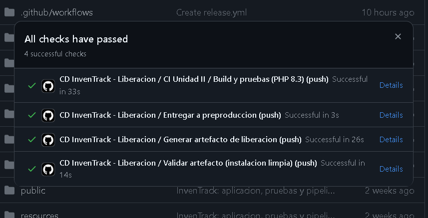
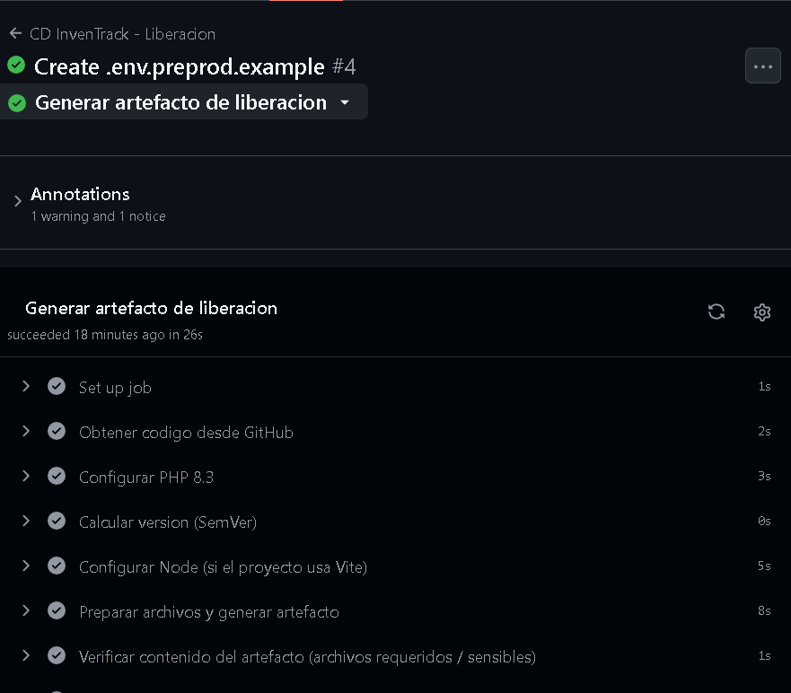

# Parte 4. Validación del artefacto

> Alumno: **Gustavo Ángel Cid Flores** · Matrícula: **222310413** · Grupo: **102**
> Versión validada: **`v1.0.0`** · Ejecución de Actions: **[#4](https://github.com/gustavoCid1/inventrack-ci/actions/workflows/release.yml)** (tag `v1.0.0`, commit `1587cf5`) · Fecha: **07/11/2026**

Las validaciones se hacen **dos veces**: automáticamente en el pipeline (jobs `build-release` y `validate`, resultado visible en el *Summary* de la ejecución) y manualmente descargando el artefacto. Guarda capturas en `docs/evidencias/`.

## 4.1 Descarga del artefacto

```bash
# Opción A: interfaz web → Actions → ejecución → sección "Artifacts" → descargar .zip
# Opción B: GitHub CLI
gh run list --workflow "CD InvenTrack - Liberacion" --limit 5
gh run download <RUN_ID> --name inventrack-release-v1.0.0 --dir ./descarga
cd descarga && sha256sum -c inventrack-release-v1.0.0.tar.gz.sha256
```

## 4.2 Comprobar contenido y ausencia de información sensible

```bash
# Listado del contenido (primeros niveles)
tar -tzf inventrack-release-v1.0.0.tar.gz | cut -d/ -f2 | sort -u

# ¿Hay .env o llaves?  (no debe imprimir nada)
tar -tzf inventrack-release-v1.0.0.tar.gz | grep -E '/\.env$|\.pem$|\.key$|id_rsa|auth\.json|\.log$'

# Verificación completa (genera reporte)
bash ../scripts/verify-artifact.sh inventrack-release-v1.0.0.tar.gz | tee ../docs/evidencias/verificacion-artefacto.md
```

## 4.3 Instalación en el ambiente de pruebas

```bash
bash ../scripts/smoke-test-artifact.sh inventrack-release-v1.0.0.tar.gz | tee ../docs/evidencias/smoke-test.md
# y/o en la VM de preproducción:
bash deploy-preprod.sh inventrack-release-v1.0.0.tar.gz v1.0.0
curl -I http://preprod.local/up
```

## 4.4 Registro de resultados

| # | Verificación | Método | Esperado | Resultado | Evidencia |
|---|---|---|---|---|---|
| 1 | Pruebas automatizadas pasan | Job `ci` | Todas en verde | ✅ OK | `evidencias/pipeline-cd.png` |
| 2 | Artefacto generado y publicado | Job `build-release` | Aparece en *Artifacts* | ✅ OK | `evidencias/10b-pasos-artefacto.png` · Actions #4 → *Summary* → *Artifacts* |
| 3 | Descarga del artefacto | `gh run download` / web | Archivo `.tar.gz` | ✅ OK | Actions #4 → *Summary* → *Artifacts* |
| 4 | Integridad SHA-256 | `sha256sum -c` | `OK` | ✅ OK | Job `validate` → paso *Comprobar integridad (SHA-256)* |
| 5 | Contiene `vendor/`, `public/index.php`, `artisan`, `app/`, `config/`, `routes/` | `verify-artifact.sh` (A) | ✅ en todos | ✅ OK | Actions #4 → *Summary* → *Verificación del artefacto* |
| 6 | **No** contiene `.env` | `verify-artifact.sh` (B) | Ausente | ✅ OK | Actions #4 → *Summary* → *Verificación del artefacto* |
| 7 | **No** contiene llaves / credenciales / `auth.json` | `verify-artifact.sh` (B, C) | Ausente | ✅ OK | Actions #4 → *Summary* → *Verificación del artefacto* |
| 8 | **No** contiene `node_modules`, `tests`, `.git`, logs | `verify-artifact.sh` (B) | Ausente | ✅ OK | Actions #4 → *Summary* → *Verificación del artefacto* |
| 9 | Sin dependencias de desarrollo (phpunit, faker…) | `verify-artifact.sh` (B) | Ausente | ✅ OK | Actions #4 → *Summary* → *Verificación del artefacto* |
| 10 | Instalación en entorno limpio (migrate, cache) | `smoke-test-artifact.sh` / job `validate` | ✅ | ✅ OK | Actions #4 → *Summary* → *Prueba de instalación* |
| 11 | Responde HTTP 200 | `curl -I .../up` | `200 OK` | ✅ OK (respuesta HTTP verificada en job `validate`) | Actions #4 → *Summary* → *Prueba de instalación* |
| 12 | Permisos de `storage/` y `bootstrap/cache/` | `ls -la` | `www-data` con escritura | ✅ OK (escritura verificada en job `validate`) | Actions #4 → *Summary* → *Prueba de instalación* |
| 13 | Versión visible | `cat current/VERSION` | `v1.0.0` | ✅ OK (`VERSION` = v1.0.0 en el paquete) | `evidencias/13-release.png` · Actions #4 → *Summary* |

## 4.5 Observaciones

- El pipeline `CD InvenTrack - Liberacion` reutiliza el CI de la Unidad II (`ci.yml`) mediante `workflow_call`; el artefacto sólo se genera si pasan Pint, PHPStan, el build de Vite y las pruebas automatizadas (Feature, Api y Unit).
- Ejecución **#4** (tag `v1.0.0`): CI Unidad II ✅ 33 s · Generar artefacto ✅ 26 s · Validar artefacto ✅ 14 s · Entregar a preproducción ✅ 3 s.
- El job *Entregar a preproducción* terminó correctamente pero **omitió el despliegue remoto** (aviso en *Annotations*) porque no se configuraron los secretos `PREPROD_HOST`, `PREPROD_USER` y `PREPROD_SSH_KEY`: el ambiente es una VM local sin acceso desde Internet. La instalación se validó en el job *Validar artefacto*, que reproduce los pasos del servidor (extraer, `.env`, `key:generate`, `migrate`, `config/route/view:cache`, permisos y respuesta HTTP), y el despliegue manual está documentado en `docs/02-ambiente-preproduccion.md` (3.6).
- La ejecución #5 aparece como cancelada porque se subió otro commit mientras corría (`concurrency: cancel-in-progress`); no es un fallo.
- **Sobre el ejemplo del docente:** comprimir con `tar ... -czf laravel-release.tar.gz .` dentro del mismo directorio incluye todo lo no excluido explícitamente (`tests/`, `.github/`, `phpunit.xml`, `.env.ci`, `vendor/` *con* dependencias de desarrollo) y puede fallar con `file changed as we read it` porque el `.tar.gz` se escribe dentro de la carpeta que se está comprimiendo. Por eso `build-release.sh` parte de `git archive`, instala `--no-dev` y escribe el paquete en `dist/`.

## 4.6 Conclusión

El artefacto **`v1.0.0`** **cumple** los criterios definidos en la Parte 1.4: pasó la integración continua (estilo, análisis estático y pruebas), no contiene `.env`, credenciales, llaves, logs ni dependencias de desarrollo, incluye `vendor/` de producción y los assets compilados de Vite (`public/build/manifest.json`), su checksum SHA-256 es íntegro y se instaló y respondió correctamente en un entorno limpio. **Está listo para validación funcional en preproducción.**

## 4.7 Evidencias

Las tablas completas de verificación y de prueba de instalación se encuentran en el *Summary* de la [ejecución #4](https://github.com/gustavoCid1/inventrack-ci/actions/workflows/release.yml) (tag `v1.0.0`), junto con el artefacto `inventrack-release-v1.0.0` descargable.







