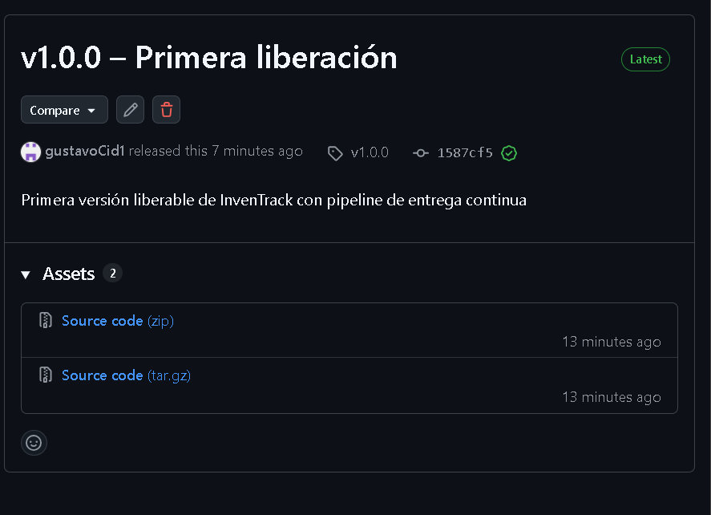

# Parte 4. Validación del artefacto

> Alumno: **[TU NOMBRE]** · Matrícula: **[MATRÍCULA]**
> Versión validada: **`v1.0.0`** · Ejecución de Actions: **[#número + enlace]** · Fecha: **[FECHA]**

Las validaciones se hacen **dos veces**: automáticamente en el pipeline (jobs `build-release` y `validate`, resultado visible en el *Summary* de la ejecución) y manualmente descargando el artefacto. Guarda capturas en `docs/evidencias/`.

## 4.1 Descarga del artefacto

```bash
# Opción A: interfaz web → Actions → ejecución → sección "Artifacts" → descargar .zip
# Opción B: GitHub CLI
gh run list --workflow "CD InvenTrack - Liberacion" --limit 5
gh run download <RUN_ID> --name inventrack-release-v1.0.0 --dir ./descarga
cd descarga && sha256sum -c inventrack-release-v1.0.0.tar.gz.sha256
```

## 4.2 Comprobar contenido y ausencia de información sensible

```bash
# Listado del contenido (primeros niveles)
tar -tzf inventrack-release-v1.0.0.tar.gz | cut -d/ -f2 | sort -u

# ¿Hay .env o llaves?  (no debe imprimir nada)
tar -tzf inventrack-release-v1.0.0.tar.gz | grep -E '/\.env$|\.pem$|\.key$|id_rsa|auth\.json|\.log$'

# Verificación completa (genera reporte)
bash ../scripts/verify-artifact.sh inventrack-release-v1.0.0.tar.gz | tee ../docs/evidencias/verificacion-artefacto.md
```

## 4.3 Instalación en el ambiente de pruebas

```bash
bash ../scripts/smoke-test-artifact.sh inventrack-release-v1.0.0.tar.gz | tee ../docs/evidencias/smoke-test.md
# y/o en la VM de preproducción:
bash deploy-preprod.sh inventrack-release-v1.0.0.tar.gz v1.0.0
curl -I http://preprod.local/up
```

## 4.4 Registro de resultados

| # | Verificación | Método | Esperado | Resultado | Evidencia |
|---|---|---|---|---|---|
| 1 | Pruebas automatizadas pasan | Job `ci` | Todas en verde | ☐ OK ☐ Falla | `evidencias/01-ci-tests.png` |
| 2 | Artefacto generado y publicado | Job `build-release` | Aparece en *Artifacts* | ☐ OK ☐ Falla | `evidencias/02-artifacts.png` |
| 3 | Descarga del artefacto | `gh run download` / web | Archivo `.tar.gz` | ☐ OK ☐ Falla | `evidencias/03-descarga.png` |
| 4 | Integridad SHA-256 | `sha256sum -c` | `OK` | ☐ OK ☐ Falla | `evidencias/04-checksum.png` |
| 5 | Contiene `vendor/`, `public/index.php`, `artisan`, `app/`, `config/`, `routes/` | `verify-artifact.sh` (A) | ✅ en todos | ☐ OK ☐ Falla | `evidencias/verificacion-artefacto.md` |
| 6 | **No** contiene `.env` | `verify-artifact.sh` (B) | Ausente | ☐ OK ☐ Falla | idem |
| 7 | **No** contiene llaves / credenciales / `auth.json` | `verify-artifact.sh` (B, C) | Ausente | ☐ OK ☐ Falla | idem |
| 8 | **No** contiene `node_modules`, `tests`, `.git`, logs | `verify-artifact.sh` (B) | Ausente | ☐ OK ☐ Falla | idem |
| 9 | Sin dependencias de desarrollo (phpunit, faker…) | `verify-artifact.sh` (B) | Ausente | ☐ OK ☐ Falla | idem |
| 10 | Instalación en entorno limpio (migrate, cache) | `smoke-test-artifact.sh` / job `validate` | ✅ | ☐ OK ☐ Falla | `evidencias/smoke-test.md` |
| 11 | Responde HTTP 200 | `curl -I .../up` | `200 OK` | ☐ OK ☐ Falla | `evidencias/11-http.png` |
| 12 | Permisos de `storage/` y `bootstrap/cache/` | `ls -la` | `www-data` con escritura | ☐ OK ☐ Falla | `evidencias/12-permisos.png` |
| 13 | Versión visible | `cat current/VERSION` | `v1.0.0` | ☐ OK ☐ Falla | `evidencias/13-version.png` |

## 4.5 Observaciones

- [Problemas encontrados y cómo se resolvieron. Ej.: "La primera ejecución falló porque `composer.lock` no estaba versionado; se agregó y se volvió a ejecutar."]
- **Nota sobre el ejemplo del docente:** comprimir con `tar ... -czf laravel-release.tar.gz .` dentro del mismo directorio incluye todo lo no excluido explícitamente (`tests/`, `.github/`, `phpunit.xml`, `vendor/` *con* dependencias de desarrollo, `.env.testing`, etc.) y puede fallar con `file changed as we read it` porque el `.tar.gz` se escribe dentro de la carpeta que se está comprimiendo. Por eso `build-release.sh` parte de `git archive`, instala `--no-dev` y escribe el paquete en `dist/`.

## 4.6 Conclusión

[Resultado global: el artefacto `v1.0.0` ☐ cumple / ☐ no cumple los criterios definidos en la Parte 1.4 y ☐ está / ☐ no está listo para validación funcional en preproducción.]

   ## Evidencias
   
