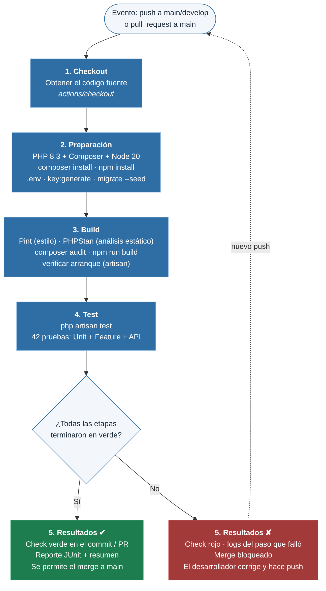

# Diseño del pipeline de CI – InvenTrack

## 1. Pasos manuales identificados (antes)

Antes del pipeline, cada integrante verificaba los cambios en su propia computadora, a mano y sin un orden fijo:

| # | Paso manual | Comando | Problema |
|---|---|---|---|
| 1 | Descargar los cambios | `git pull` | Se probaba sobre código desactualizado |
| 2 | Instalar dependencias PHP | `composer install` | Se olvidaba tras cambios en `composer.lock` |
| 3 | Instalar dependencias JS | `npm install` | Versiones distintas entre equipos |
| 4 | Preparar el entorno | `cp .env.example .env` · `php artisan key:generate` | `.env` diferente en cada máquina |
| 5 | Preparar la base de datos | `php artisan migrate --seed` | Migraciones pendientes no detectadas |
| 6 | Compilar el frontend | `npm run build` | Error "Vite manifest not found" en otra máquina |
| 7 | Revisar estilo | (no se hacía) | Estilo inconsistente en los PR |
| 8 | Ejecutar pruebas | `php artisan test` | Se omitía por prisa; errores llegaban a `main` |
| 9 | Avisar al equipo | mensaje por chat | Sin evidencia ni historial |

Tiempo aproximado: **10–15 min por cambio**, dependiente de la disciplina de cada persona.

## 2. Flujo automatizado (después)

| Etapa | Pasos en `ci.yml` | Sustituye a |
|---|---|---|
| 1. Checkout | `actions/checkout@v4` | Paso 1 |
| 2. Preparación | `setup-php` (8.3), `composer validate`, caché, `composer install`, `setup-node` (20), `npm install`, `.env.ci`, `key:generate`, `migrate --seed` | Pasos 2–5 |
| 3. Build | `pint --test`, `phpstan analyse`, `composer audit`, `npm run build`, arranque (`about`, `route:list`, `inventario:alertas`) | Pasos 6–7 |
| 4. Test | `php artisan test --log-junit reports/junit.xml` | Paso 8 |
| 5. Resultados | `upload-artifact` (JUnit y logs) + resumen en `$GITHUB_STEP_SUMMARY` + check ✔/✘ en el commit/PR | Paso 9 |

Las etapas siguen el principio *fail fast*: las verificaciones más rápidas (estilo, análisis estático) van antes que las pruebas,
y si un paso falla los siguientes no se ejecutan.

## 3. Eventos que inician el pipeline

| Evento | Configuración | Justificación |
|---|---|---|
| `push` | ramas `main` y `develop` | Cada cambio subido a una rama compartida se valida de inmediato |
| `pull_request` | hacia `main` | Verifica los cambios **antes** de integrarlos a la rama principal (objetivo de la actividad) |
| `workflow_dispatch` | manual | Permite re-ejecutar el pipeline para demostración o diagnóstico |

`concurrency` con `cancel-in-progress` cancela ejecuciones viejas de la misma rama para no gastar minutos de CI.

## 4. Condiciones de aprobación o rechazo

| Etapa | Se **aprueba** si… | Se **rechaza** si… |
|---|---|---|
| Preparación | `composer validate --strict` válido y dependencias instaladas | lock desactualizado, paquete inexistente, migración con error |
| Estilo (Pint) | 0 archivos por corregir | algún archivo no cumple PSR-12/preset Laravel |
| PHPStan | 0 errores en nivel 5 | cualquier error de tipos o variable indefinida |
| Auditoría | siempre (informativa) | – (solo advierte vulnerabilidades) |
| Build frontend | `npm run build` genera `public/build/manifest.json` | error de compilación de Vite |
| Arranque | comandos Artisan terminan con código 0 | error de configuración o de rutas |
| Pruebas | **100 %** de las pruebas aprobadas | al menos una prueba falla |

Resultado global: **aprobado (✔)** solo si todas las etapas bloqueantes pasan. Con la regla de protección de rama
(*Settings → Branches → Require status checks to pass*) GitHub impide fusionar un PR con el check en rojo.

## 5. Justificación de herramientas

| Herramienta | Por qué se eligió | Alternativa considerada |
|---|---|---|
| **GitHub Actions** | El repositorio ya está en GitHub; gratuito; configuración en YAML versionada con el código; integra el check en los PR | Jenkins (requiere servidor propio), GitLab CI (otro proveedor) |
| **shivammathur/setup-php** | Acción estándar para instalar PHP y extensiones en segundos | Imagen Docker propia (más mantenimiento) |
| **SQLite en CI** | No requiere contenedor de BD; las pruebas tardan ~1–2 s; las migraciones son portables a MySQL | Servicio MySQL 8 (más lento; queda como mejora) |
| **PHPUnit vía `php artisan test`** | Es lo que pide la actividad; incluido en Laravel; genera JUnit XML. Pest (propuesto en la Act. 08) corre sobre PHPUnit y se puede adoptar después sin cambiar el pipeline | Pest |
| **Laravel Pint** | Incluido en Laravel; un solo comando para revisar estilo | PHP_CodeSniffer |
| **PHPStan + Larastan** | Detecta errores sin ejecutar el código y entiende Eloquent | Psalm, SonarCloud |
| **composer audit** | Integrado en Composer, sin configuración | Dependabot (complementario) |
| **Node 20 + Vite** | Versión LTS; Laravel 11 compila assets con Vite | – |
| **actions/cache** | Reutiliza `vendor/` entre ejecuciones si `composer.lock` no cambia | – |

## 6. Problemas encontrados y soluciones

| # | Problema | Evidencia | Posibles soluciones | Solución seleccionada |
|---|---|---|---|---|
| 1 | 3 pruebas fallaban con `Vite manifest not found` porque las vistas usan `@vite` y el frontend no estaba compilado | `evidencias/01-fallo-vite-manifest.txt` | a) compilar antes de las pruebas; b) `withoutVite()` en `TestCase`; c) guardar `public/build` en Git | **b + a**: las pruebas no dependen del build y el build se verifica en su propia etapa (3.4) |
| 2 | Pint marcó 2 archivos del esqueleto (`config/auth.php`, `bootstrap/providers.php`) | `evidencias/03-pint-antes.txt` | corregir a mano; ejecutar `vendor/bin/pint`; excluirlos | **Ejecutar `vendor/bin/pint`** y versionar `pint.json` |
| 3 | PHPStan: `Undefined variable: $this` en `routes/console.php` (comando de ejemplo `inspire`) | `evidencias/04-phpstan-antes.txt` | ignorar el error; bajar el nivel; mover la lógica a una clase | **Clase `AlertasStockCommand`** con firma tipada |
| 4 | El heredoc de Python dentro del paso de resumen no cerraba por la indentación de YAML | revisión del `ci.yml` | quitar indentación; usar `<<-`; script aparte | **Script `scripts/ci-summary.py`** |
| 5 | `npm ci` falla si no existe `package-lock.json`, y `setup-node` con `cache: npm` también | revisión del `ci.yml` | generar el lock; usar `npm install` | **Condicional**: `npm ci` si hay lock, si no `npm install` |

Prueba de rechazo: al cambiar `TASA_IVA` de 0.16 a 0.15, **6 pruebas fallan** y el pipeline termina con código 1
(`evidencias/08-regresion-detectada-iva.txt`). Esto demuestra que una regresión no puede llegar a `main` sin ser detectada.

## 7. Mejoras futuras

- Servicio MySQL 8 en el pipeline para probar con el motor de producción.
- Cobertura de código con PCOV y umbral mínimo (`--coverage --min=70`).
- Pruebas E2E con Laravel Dusk y de carga con k6 (propuestas en la Actividad 08).
- Matriz de versiones de PHP (8.2 y 8.3).
